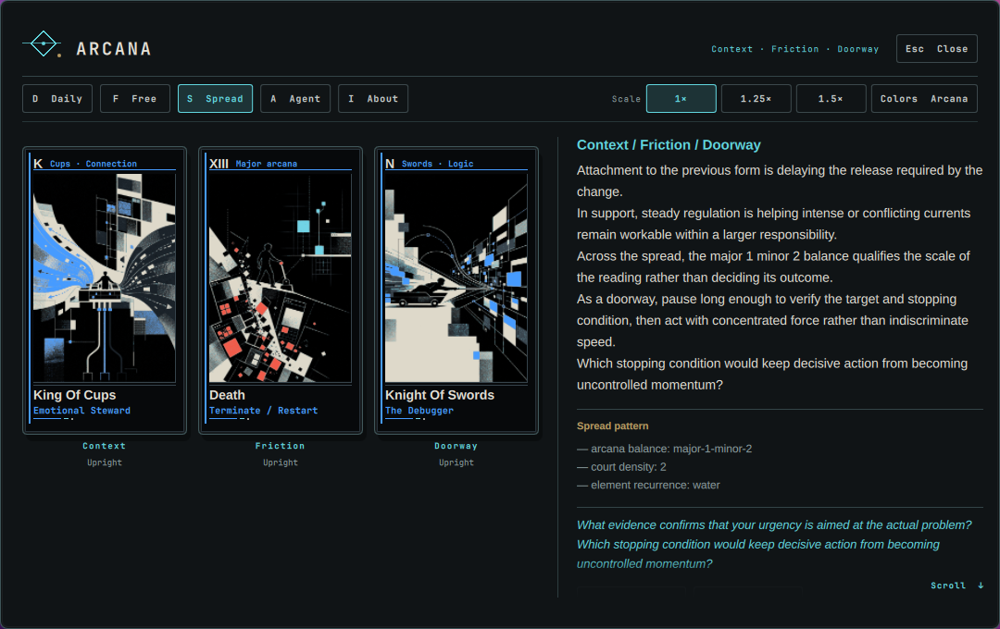

# Arcana

**Order surrounding mystery.**

Arcana is a standalone Omarchy Quattro/Quickshell plugin that turns a complete 78-card original tarot deck into a keyboard-first reflective system.



## Alpha capabilities

- Complete 78-card deck with `536×786` illustration plates, a reversible-back artwork, and resolution-independent QML card chrome
- Stable local-date daily draw
- Repeatable free draws
- Three-card `Context / Friction / Doorway` spread drawn without replacement
- Optional upright and typed reversed/shadow orientations
- Deterministic constrained interpretive synthesis
- Evidence-linked traditional, deck-specific, orientation, position, relationship, and pattern layers
- XDG-local JSON persistence
- Quiet bar widget and floating keyboard-first panel
- Persistent `1×`, `1.25×`, and `1.5×` panel scaling, plus a **Full** option that fills the current output
- Persistent `ARCANA` / `SYSTEM` color mode with theme-responsive card spot colors; structural black/ivory remains fixed
- Staged panel reveal plus physical card motion: hover/focus lift, face-down draws, click/keyboard flip reveals, and a large second-click inspection view
- Explicit **Ask Your Agent** packet preview using Omarchy’s configured default agent

Agent prose is optional and non-canonical. Arcana never treats tarot as prophecy, diagnosis, professional advice, or factual authority.

## Requirements

- Omarchy **4.0.2-1** with its Quattro shell and Quickshell **0.3.1** is the release test target. Older versions are not certified.
- A Wayland session; `wl-copy` (wl-clipboard) for copying readings and GNU coreutils (`mkdir`, `od`) for local state and randomness.
- An Omarchy-configured default agent is optional. No account or network connection is needed for local readings.
- Development: Node **22.15+**, GNU tar/gzip, Qt 6's `qmltestrunner`, and Quickshell. The QML test script uses Arch's `/usr/lib/qt6/bin/qmltestrunner` path.

## Installation

```bash
omarchy plugin add https://github.com/OldJobobo/arcana
```

This installs the current upstream branch, not an immutable release snapshot. For a locally validated archive, build and install using the steps below. On the tested Omarchy version, `omarchy plugin add` clones Git repositories; it does **not** install an extracted archive or uncommitted checkout changes.

Add **Arcana** to the Quattro bar from shell settings if it is not placed automatically. Summon it directly with:

```bash
omarchy-shell shell summon org.ministryoftaste.arcana '{}'
```

## Install a local release archive

```bash
npm run validate
npm run package
cd dist
sha256sum -c arcana-0.1.0-alpha.tar.gz.sha256
unpack=$(mktemp -d ./arcana-unpack.XXXXXX)
tar -xzf arcana-0.1.0-alpha.tar.gz -C "$unpack"
cd "$unpack"
omarchy plugin validate ./org.ministryoftaste.arcana
plugins="$HOME/.config/omarchy/plugins"
test ! -e "$plugins/org.ministryoftaste.arcana" && test ! -L "$plugins/org.ministryoftaste.arcana" || exit 1
mkdir -p "$plugins"
stage=$(mktemp -d "$HOME/.config/omarchy/.arcana-install.XXXXXX")
cp -R -- ./org.ministryoftaste.arcana "$stage/"
mv -- "$stage/org.ministryoftaste.arcana" "$plugins/"
rmdir -- "$stage"
omarchy-shell shell rescanPlugins
# Discovery is asynchronous; wait before enabling in a pasted command block.
for attempt in {1..50}; do
  omarchy plugin list --json | jq -e 'any(.[]; .id == "org.ministryoftaste.arcana")' >/dev/null && break
  sleep 0.1
done
omarchy plugin enable org.ministryoftaste.arcana
```

The archive contains runtime files, notices, and user documentation—not tests, research tooling, graph caches, or local VM access material. The checksum checks integrity, not publisher identity. For local updates, remove the installed plugin with `omarchy plugin remove org.ministryoftaste.arcana`, then repeat the validated archive-copy steps and run `omarchy restart shell` to discard cached QML components. Local state is retained. Git-based `plugin update` is not applicable to this archive installation.

To remove the plugin, run `omarchy plugin remove org.ministryoftaste.arcana`. This does not erase the saved reading; see **Recovery and clearing data** below.

## Keyboard

| Key | Action |
| --- | --- |
| `D` | Daily draw |
| `F` | Free draw |
| `S` | Context / Friction / Doorway |
| `A` | Ask Your Agent preview |
| `I` | Method and provenance |
| `E` / `C` | Expand/compact interpretation / copy current reading |
| `T` | Toggle Arcana identity colors / active Omarchy theme colors |
| `1` / `2` / `3` | Set panel scale to `1×` / `1.25×` / `1.5×` without changing fullscreen |
| `F11` / **Full** | Toggle fullscreen on the current output; the previous scale is retained |
| `R` | Confirmed daily redraw flow |
| `Tab` / `Shift+Tab` | Move focus between face-down cards and controls |
| `Enter` / `Space` | Reveal the focused card; press again to inspect it at large size |
| `/` | Focus the optional agent question |
| `Esc` / `Q` | Back or close; Esc leaves fullscreen before closing the reading view |

Middle-clicking the bar sigil performs a free draw without opening the panel; left-click opens or closes the panel.

## State and trust boundary

State is stored in `${XDG_STATE_HOME:-~/.local/state}/omarchy/arcana.json`. The plugin stores only current daily selection, last reading, draw counter, and local preferences, including panel scale and color mode. Scale, fullscreen, and color mode persist across panel close, plugin reload, and shell restart. **Full** expands the panel to fill the current output without changing the framed view’s rendered scale—text, cards, and controls stay the same size; fullscreen is an independent toggle, so you can change scale while staying fullscreen. Both the chosen scale and **Full** remain highlighted. Fullscreen uses the full canvas: edge-aligned controls, a dedicated card area with responsive card spacing, and a separate reading area. Supporting details move into a side column when space allows and return beneath the narrative at larger scales or on smaller outputs. Text measure stays bounded; card and type sizes still follow your chosen scale. On smaller displays the rendered size fits within the available output without changing the saved scale. `SYSTEM` color mode follows Quattro’s live popup, text, accent, muted, border, and urgent roles. Card silhouettes, ivory fields, linework, typography, identity, orientation, and reading state remain fixed; only packaged primary, secondary, and fault spot-color masks respond to the selected color mode. Low-contrast system colors fall back deterministically to the ARCANA signal palette. Fault coverage is intentionally sparse: nine cards carry fault pixels for meaningful failure, conflict, warning, or destructive states, while the other 70 images retain transparent fault layers so every image uses the same three-mask renderer. The exact set is declared in `assets/card-art-masks/fault-contract.json` and enforced by the release validator. The plugin does not read arbitrary files, shell history, environment dumps, vault content, credentials, or unrelated state.

**Question privacy:** updating the agent preview saves the original question and its reframed form inside the last reading, before any agent launch. These are plaintext local data and are restored after restart. Preparing another question replaces them; an ordinary new draw clears the question from the last reading. The input field itself is transient. To remove all saved data, follow the clearing procedure below. Copying also places reading/question text on the Wayland clipboard, which a clipboard-history manager may retain.

The agent handoff contains only the current reading and an optional, clearly delimited user question. It uses argument-array process launch through:

```text
omarchy default agent
omarchy agent prompt <bounded-packet>
```

The launch is never automatic. Omarchy agents may run with unattended/auto-approval behavior, so the panel previews the exact packet and requires an explicit launch action.

## Recovery and clearing data

Arcana preserves unreadable, malformed, and unsupported-version state instead of overwriting it. The panel offers **Retry loading** after you repair the file or permissions. Failed saves leave the reading usable in memory and offer **Retry saving**; do not restart until saving succeeds if you want to retain it. Randomness failure preserves the previous reading; retry the desired draw. **Retry copy** requires a working `wl-copy`/Wayland session.

To reset safely, disable the plugin before moving the state file. This also clears saved questions from Arcana's active state, but a backup retains them:

```bash
omarchy plugin disable org.ministryoftaste.arcana
state="${XDG_STATE_HOME:-$HOME/.local/state}/omarchy/arcana.json"
# Only if the file exists; retain this backup until you have verified the reset.
mv -- "$state" "$state.backup-$(date +%s)"
omarchy plugin enable org.ministryoftaste.arcana
```

For permanent deletion, remove the state file and any backups you no longer want while Arcana is disabled. Clear clipboard history separately if you copied a reading. Re-enabling starts with fresh defaults. External edits are read on reload/restart or **Retry loading**, not merged into a running reading.

## Development and release checks

```bash
npm run validate   # Node, QML, real I/O, complete triple matrix, asset/release checks
npm run package    # reproducible archive and SHA-256 checksum in dist/
```

CI checks Node behavior, assets, packaging, and the complete upright triple matrix. QML and live-shell tests remain separate local gates. Validation evidence and the exact tested boundary are recorded in [Release readiness](docs/RELEASE-READINESS.md).

## License

Plugin source and release documentation are **MIT**. Original artwork, masks, authored deck data, and the Major/Minor Arcana guides are **CC BY-NC-ND 4.0**: noncommercial sharing with attribution; no distribution of adaptations. Attribution: **Arcana — Ministry of Taste / OldJobobo, 2026**. Public-domain historical sources remain public domain. See [LICENSE](LICENSE) and the [asset license](LICENSES/CC-BY-NC-ND-4.0.txt).
